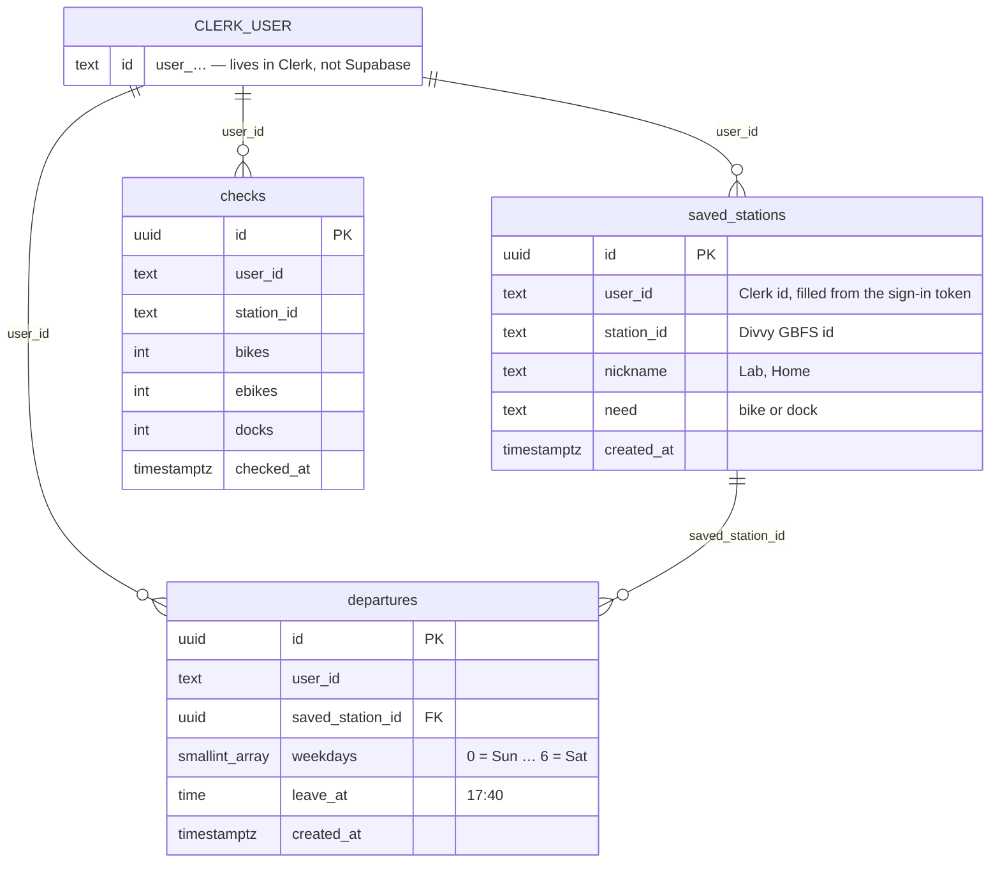

# What I built, and how it works

The brief ends each step with an "Ask your agent" prompt. These are the answers, about this app, in the order of the steps. Diagrams are Mermaid, so GitHub draws them.

---

## 1. The Divvy response: what each field means

*"Explain this response: what each field means, and which ones my tool needs."*

A live call on 2026-10-24 returned 2,076 stations. Two feeds, joined by `station_id`:

| Field | Example (Ellis Ave & 58th St) | Meaning | DockCheck uses it? |
|---|---|---|---|
| `station_id` | `a3aabfe3-…-0a87ae2ba916` | permanent id shared by both feeds | ✅ stored in `saved_stations.station_id` |
| `name` | Ellis Ave & 58th St | display name | ✅ search and labels |
| `capacity` | 19 | total docks | ✅ "of 19" |
| `num_bikes_available` | 0 | rentable bikes, **e-bikes included** | ✅ |
| `num_ebikes_available` | 0 | e-bikes only (classic = total − e-bikes) | ✅ "2 left, both e-bikes" |
| `num_docks_available` | 18 | free docks to return a bike | ✅ when you need a dock |
| `is_renting` / `is_returning` | 1 / 1 | station open for taking / returning | ✅ "not renting right now" |
| `last_reported` | unix time | when the station last checked in | ✅ |
| feed `last_updated`, `ttl` | 50 s old, 60 | how fresh the feed is | ✅ older than 5 min = "data may be old" |
| `num_*_disabled`, `rental_uris`, `eightd_*`, `legacy_id`, `lat`/`lon` | | broken bikes, Lyft app links, kiosk details, map position | no |

**When a search finds nothing:** GBFS has no search. We filter names ourselves, and no match is just an empty list. A `station_id` that no longer exists is simply missing from the feed, not an error. Both are the "nothing found" state.

---

## 2. My tables, and how each row belongs to one person

*"Draw a diagram of my tables: what each one holds, and how each row belongs to one person."*



- **saved_stations:** the stations you use, with your name for each, and whether you need a bike or a dock there.
- **departures:** when you usually leave from one of your saved stations ("Mon–Fri at 5:40 PM").
- **checks:** what was at a station each time you opened the app. This is what powers "empty 3 of 5 times you checked around then", from your own history only.

**How a row belongs to one person:** every table has `user_id`, and its default is `auth.jwt() ->> 'sub'`, the Clerk user id inside the sign-in token Supabase receives. The app never sends a user id itself, so it can't send the wrong one. Row-level security then only lets you touch rows whose `user_id` is yours (section 5).

---

## 3. The deny rule, and publishable vs secret keys

*"Explain why this deny rule protects my keys. Then explain the difference between my publishable and secret keys, and where each one is allowed to go."*

`.claude/settings.json`:

```json
{ "permissions": { "deny": ["Read(./.env)", "Read(./.env.*)"] } }
```

**Why it protects the keys:** anything the agent reads goes into the conversation, and can then end up in a transcript, a log, or a file it writes. With the deny rule, the agent can't open `.env.local` at all, so the keys never enter its context. It was committed *before* any key existed (commit `664ad2f`). I created `.env.local` and pasted the keys myself. `clerk init` wrote its part when **I** ran it, not the agent. `.gitignore` has `.env*`, so the file can't be committed either.

| Key | Example prefix | Allowed where | Why |
|---|---|---|---|
| Clerk **publishable** | `pk_test_…` | browser, code, anywhere | only identifies which Clerk app to talk to |
| Supabase **publishable** | `sb_publishable_…` | browser, anywhere | only identifies the project; RLS decides what it can reach |
| Supabase URL | `https://….supabase.co` | anywhere | an address |
| Clerk **secret** | `sk_test_…` | **server only**: `.env.local`, Vercel env vars | can act as the whole Clerk app (create users, issue sessions) |
| Supabase **secret / service_role** | `sb_secret_…` | **not used at all** | it bypasses RLS; we don't need it because every query runs as the signed-in user |

Rule of thumb: `NEXT_PUBLIC_…` variables are bundled into the browser on purpose; everything else stays on the server.

---

## 4. What `clerk init` added, file by file

*"Show me how the Clerk CLI works: what clerk init added to my project, file by file."*

| File | What it does |
|---|---|
| `src/middleware.ts` | runs Clerk on every request so the server knows who is signed in. On its own it **protects nothing**. |
| `src/app/layout.tsx` | wraps the app in `<ClerkProvider>` so any page can ask "who is this?" |
| `src/app/sign-in/[[...sign-in]]/page.tsx` | Clerk's ready-made sign-in form at `/sign-in` |
| `src/app/sign-up/[[...sign-up]]/page.tsx` | Clerk's sign-up form at `/sign-up` |
| `.env.local` | the two Clerk keys plus the sign-in/sign-up URLs (written by me running the CLI) |

The CLI also logged in to Clerk, linked this folder to the Clerk app, and tried to install `@clerk/nextjs`. That failed because it needed React ≥ 19.1.4, so React was patched to 19.1.10 first. Because the middleware protects nothing, **every page, route and server action calls `await auth.protect()` itself** (rule in `AGENTS.md`).

---

## 5. Each RLS policy in plain words, and a query one would block

*"Explain each row-level security policy in plain words, then show me a query that one of them would block."*

From `supabase/migrations/20261024093146_initial_tables.sql`. "You" = the Clerk user id in the token (`auth.jwt() ->> 'sub'`).

| Table | Policy | In plain words |
|---|---|---|
| saved_stations | Users see their own saved stations | You can only read rows where `user_id` is you. |
| saved_stations | Users add their own saved stations | You can only add a row whose `user_id` is you. |
| saved_stations | Users change their own saved stations | You can only edit your rows, and can't hand them to someone else. |
| saved_stations | Users delete their own saved stations | You can only delete your rows. |
| departures | Users see their own departures | Only your departure times. |
| departures | Users add departures to their own stations | You can add a departure only for yourself **and** only to a station you saved. |
| departures | Users change their own departures | Same two checks when editing. |
| departures | Users delete their own departures | Only yours. |
| checks | see / add / change / delete their own checks | Only your own history. |

Also: signed-out visitors (`anon`) have **no grants** on any table, so they can't even ask.

**Queries that get blocked.** User B is signed in and knows user A's ids:

```js
// B tries to read A's stations: returns [] — the SELECT policy hides every row that isn't B's.
await supabase.from("saved_stations").select("*").eq("user_id", "user_A_id");

// B tries to attach a departure to A's station: rejected with
// "new row violates row-level security policy for table departures".
await supabase.from("departures").insert({ saved_station_id: "A's station uuid", weekdays: [1], leave_at: "17:40" });

// B tries to steal A's row: updates 0 rows — B can't see it, so can't change it.
await supabase.from("saved_stations").update({ user_id: "user_B_id" }).eq("id", "A's station uuid");
```

---

## 6. One request, from the click to the screen

*"Draw a diagram of one request, from the click to the screen: the browser, my server, Clerk, Supabase, and the API."*

Saving Ellis & 58th as "Lab":

```mermaid
sequenceDiagram
    actor You
    participant B as Browser
    participant S as Next.js server (Vercel)
    participant C as Clerk
    participant D as Divvy GBFS
    participant DB as Supabase (Postgres + RLS)

    You->>B: type "ellis"
    B->>S: GET /api/stations?q=ellis (session cookie)
    S->>C: auth.protect(): is this session valid?
    C-->>S: yes, user_…
    S->>D: station_information.json (cached 60 s, shared by everyone)
    D-->>S: 2,076 stations
    S-->>B: up to 10 matches
    You->>B: pick it, name it "Lab", Save
    B->>S: Server Action saveStation (session cookie)
    S->>C: auth.protect() + getToken()
    C-->>S: signed JWT, sub = user_…
    S->>D: is this station_id real? (cached)
    S->>DB: INSERT saved_stations, Authorization: Bearer <Clerk JWT>
    DB->>C: verify JWT signature (third-party auth trusts this Clerk instance)
    DB->>DB: user_id defaults to sub; RLS INSERT check passes
    DB-->>S: row saved
    S->>S: revalidate "/" → re-render your page
    S->>DB: SELECT your stations (RLS returns only yours)
    S->>D: station_status.json (cached 60 s)
    S-->>B: HTML: "Lab — 2 bikes left, both e-bikes"
```

**Where the app knows who you are:** Clerk's middleware reads the session cookie on every request, and `auth.protect()` stops anyone without one. **Where it decides what you may see:** in Supabase. Every query carries your Clerk token, and RLS returns only rows whose `user_id` matches it. Even a bug in our server code can't show someone else's rows.

**Where the API is called, and why there:** on our server, in `src/lib/gbfs.ts`. Not for keys (Divvy needs none). The reasons are **size and caching**: the two feeds are about 1.9 MB together. One cached fetch every 60 s (the feed's `ttl`) serves every user, instead of each phone downloading the whole city.

**Designed states:**
- **Loading:** skeleton cards (`loading.tsx`), and skeleton rows while searching.
- **Nothing found:** "No station matches 'zzz'", or a saved station Divvy no longer lists.
- **API down** (error, timeout over 8 s, or `/?demo=api-down`): "Divvy isn't responding right now", with your last known counts and their time.
- **Stale:** feed older than 5 min, "counts may be old".

Tested in `e2e/states.spec.ts`.

---

## 7. Why the test failed when I broke RLS

*"Explain why the test failed when I broke row-level security, in one sentence I could say in class."*

> I changed the read policy on `saved_stations` to `using (true)`, so Supabase handed every signed-in user everyone's saved stations, and user B's screen showed user A's station: 1 where the test expected 0.

Evidence: `docs/evidence/test-failing-rls-broken.txt`, then `docs/evidence/test-passing-rls-fixed.txt` after `e2e/fix-rls.sql`.

---

## 8. Free tiers, and usage limits and alerts

*"Walk me through the free tier limits for each service my app uses, and how to set usage limits and spending alerts for each one."*

Figures from third-party 2026 guides; check each pricing page before relying on an exact number.

| Service | Free tier (approx.) | What happens at the limit | Limits and alerts |
|---|---|---|---|
| **Vercel Hobby** | ~100 GB transfer/month, function invocations and Active CPU allowances | Hobby has no billing, so no charges. Vercel emails at usage thresholds; going over can pause or limit the project | No card on file. Watch **Project → Usage**; notification emails are on by default |
| **Supabase Free** | 500 MB database, 50,000 monthly active users, 5 GB egress, 2 active projects | Hard stop, no overage bill. **Pauses after 7 days without use** | No card, so no spend possible. Check **Organization → Usage**. (The spend cap setting exists only on Pro, where it's on by default.) Open the app weekly until grades are back |
| **Clerk Hobby** | 50,000 monthly retained users per app (counted only if they return 24 h after sign-up) | Would need a paid plan beyond that | No card. We use the **development instance** only, as the brief requires. Usage on the dashboard Overview |
| **Divvy GBFS** | Public, no key | Could rate-limit abusive clients | Our 60 s server cache means at most ~2 requests a minute, however many users |

Nothing here has a payment method, so nothing can charge. That's the brief's "avoid adding a payment method" rule.

Sources: [Supabase pricing guide (jetadmin)](https://www.jetadmin.io/blog/supabase-pricing-2026-guide-to-plans-limits-and-real-world-costs/), [Supabase free tier (activepieces)](https://www.activepieces.com/blog/supabase-pricing-free-tier-limits-pro-costs-egress.md), [Vercel limits](https://vercel.com/docs/limits), [Vercel free tier 2026 (deploywise)](https://deploywise.dev/blog/vercel-free-tier-limits-2026), [Vercel community: Hobby invocations](https://community.vercel.com/t/vercel-hobby-plan-function-invocation-limit-discrepancy-1-million-vs-100k-notification/32767), [Clerk pricing explained](https://clerk.com/articles/clerk-pricing-explained).

---

## 9. Agentic workflow: what I stopped the agent from doing, and what I caught

- **Keys:** the agent wanted to run `clerk init`. I ran it myself, because it writes keys into `.env.local`, and the agent never writes that file. When I wanted the agent to paste the Supabase keys in, it refused and gave me a one-line command to run instead.
- **Database:** I declined the agent's in-database test query, and I declined it "fixing" RLS for me after the failing test; I ran `fix-rls.sql` myself. Claude Code's auto mode also blocked the agent from weakening RLS, so **I** broke it on purpose in the SQL Editor.
- **Caught while reading changes:**
  - `npm audit` showed a critical Next.js bug (image optimizer RCE), patched to 15.5.28.
  - Supabase's advisor flagged `rls_auto_enable()` as callable by anyone; revoked in a migration.
  - Clerk had deprecated `createRouteMatcher`, so protection moved into each page.
  - The first "failing" test run failed for the wrong reason (a slow save, not RLS), so it wasn't counted as evidence.
  - I pasted the Clerk secret key into the chat by mistake, so it has to be rotated in Clerk and replaced in Vercel and `.env.local`.
